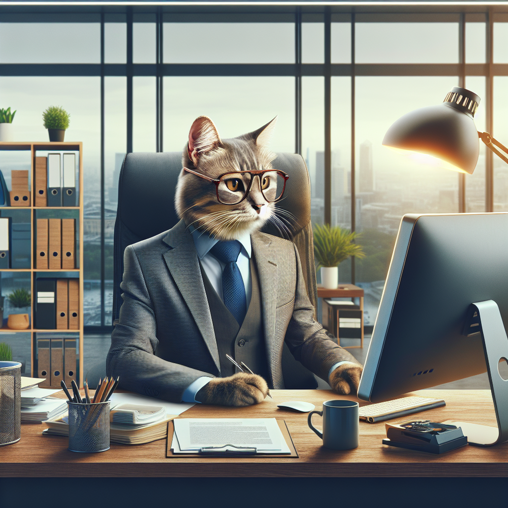
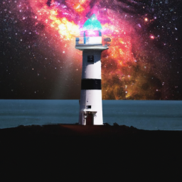
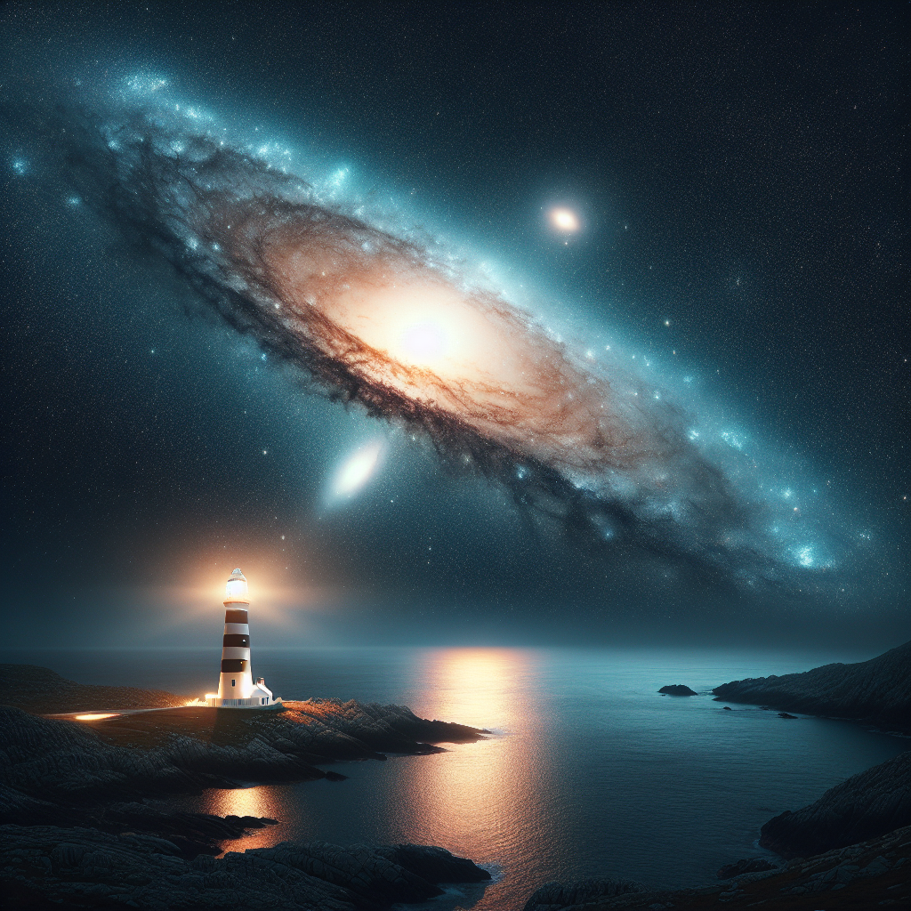
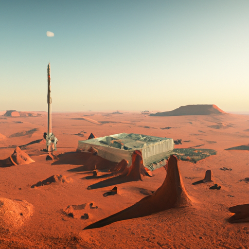
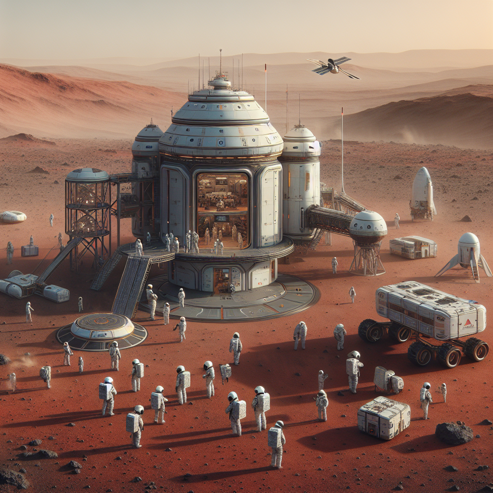
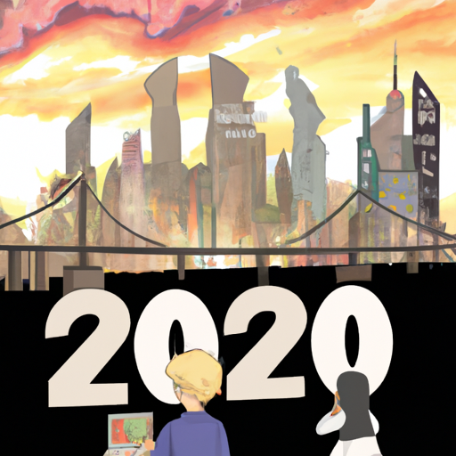
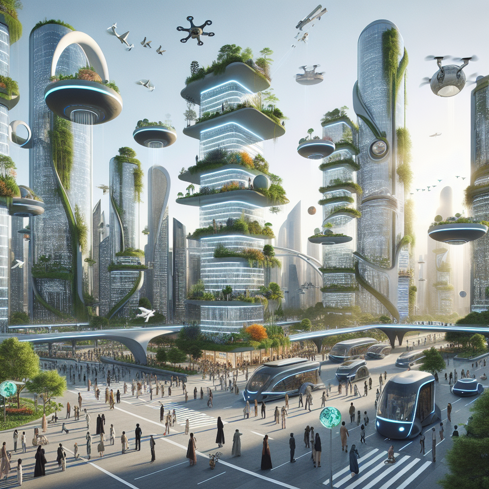
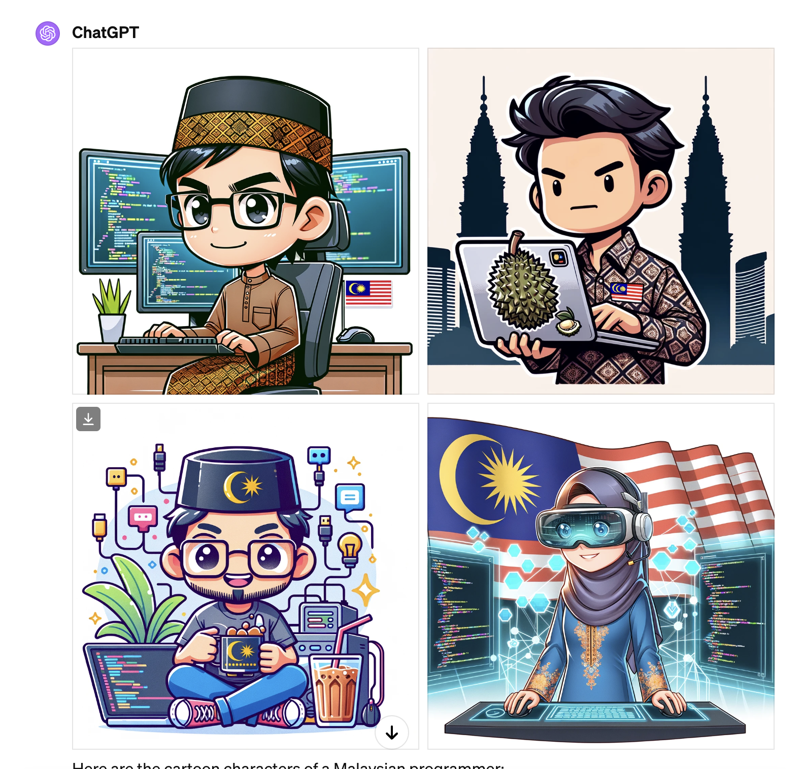
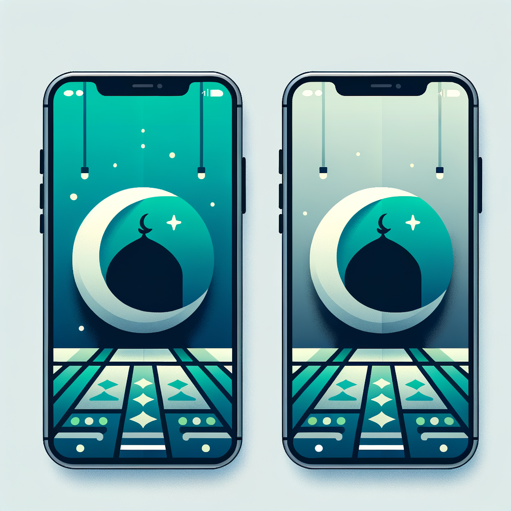

In September 2023, OpenAI announced a new text-to-image model, [Dall·E 3](https://openai.com/dall-e-3). I first got the opportunity to try Dall·E 3 when my company gave access to ChatGPT Pro, which includes the Dall·E 3 model. I am pretty excited because the images generated are far better than Dall·E 2 that I've explored some time ago.

So today, I created a simple [python program](https://github.com/iqfareez/openai-dall-e3) and incorporated OpenAI's Image Generation API to redo the prompt from the previous Dall·E 2 experiment. Note that the Dall·E 2 images shown below were generated in November 2022.

Below is the image comparison of Dall·E 2 and Dall·E 3. _Sorry for the inconsistent image sizes._

### 1. A realistic image of a boss cat doing work in the office

| Model | Image |
| --- | --- |
| Dall·E 2 |  |
| Dall·E 3 |  |

**Dall·E 2:** Totally unsatisfying, the picture is not realistic at all.

**Dall·E 3:** The picture is much more realistic and nicely composed. Also, cute.

### 2. A digital art of a lighthouse with the Andromeda galaxy in the background

| Model | Image |
| --- | --- |
| Dall·E 2 |  |
| Dall·E 3 |  |

**Dall·E 2:** Good, just a bit cartoonish

**Dall·E 3:** Satisfied. Nicely composed. But it looks like Earth has no atmosphere at all (The galaxy should look faded, but I assume maybe it uses a long focal length setting)

### 3. Realistic image of human civilization on Mars

| Model | Image |
| --- | --- |
| Dall·E 2 |  |
| Dall·E 3 |  |

**Dall·E 2:** Ok good enough

**Dall·E 3:** Better, have more life

### 4. A depiction of life in the year 3040

| Model | Image |
| --- | --- |
| Dall·E 2 |  |
| Dall·E 3 |  |

**Dall·E 2:** Looks stressful, apocalypse-like scenario (maybe because this image was generated just after the spike of the Covid-19 era)

**Dall·E 3:** Future-modern life like depicted in most of my primary school textbooks

### 5. Profile picture with a man and cat in a tech environment

| Model | Image |
| --- | --- |
| Dall·E 2 |  |
| Dall·E 3 |  |

**Dall·E 2:** Good enough, but why is the cat sad though

**Dall·E 3:** Not composed nicely. The cat looks more realistic than the human.

## Bonus

### Malaysia Programmer (Generated via ChatGPT using Dall·E model)

### Malaysia Prayer time logo for mobile app

Overall, I think Dall·E 3 is now able to generate results that are richer in context and eye-pleasing. For those who want to see the python script used to generate the images, please refer to the GitHub repository [openai-dalle2](https://github.com/iqfareez/openai-dalle2) & [openai-dall-e3](https://github.com/iqfareez/openai-dall-e3#example-results).
